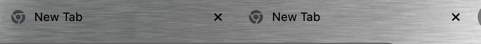
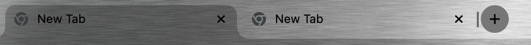

# Revised Brushed

A Revised [Brushed](https://chromewebstore.google.com/detail/brushed/bfjgbcjfpbbfepcccpaffkjofcmglifg) Theme for Google Chrome

- The original `Brushed` theme is hard to distinguish between the active and inactive tabs.
  This theme makes the active tab more obviously different from the inactive tabs.
- Original:
  
- Revised:
  

## Installation

1. Download the **Source code (zip)** archive from [Releases](https://github.com/likelikeslike/brushed_chrome_theme/releases) and extract it.
2. Open `chrome://extensions/` and enable **Developer mode**.
3. Click **Load unpacked** and select the extracted folder containing `manifest.json` and `imgs/`.

Dragging the release `.crx` into Chrome can fail with `CRX_REQUIRED_PROOF_MISSING` because it does not have the Chrome Web Store publisher proof required for direct installation. For regular installation without Developer mode, publish the theme through the Chrome Web Store.
